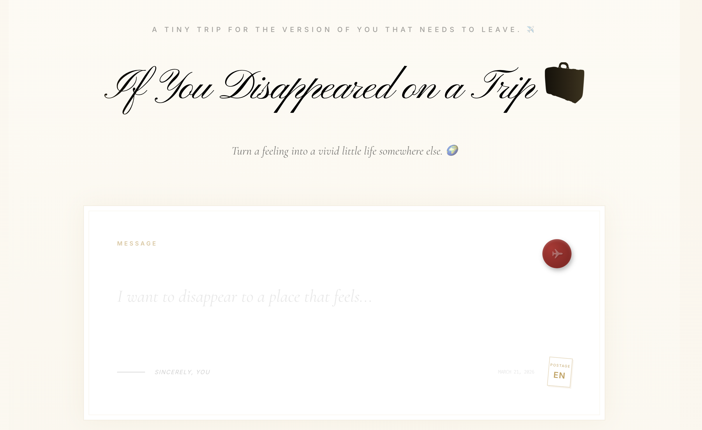
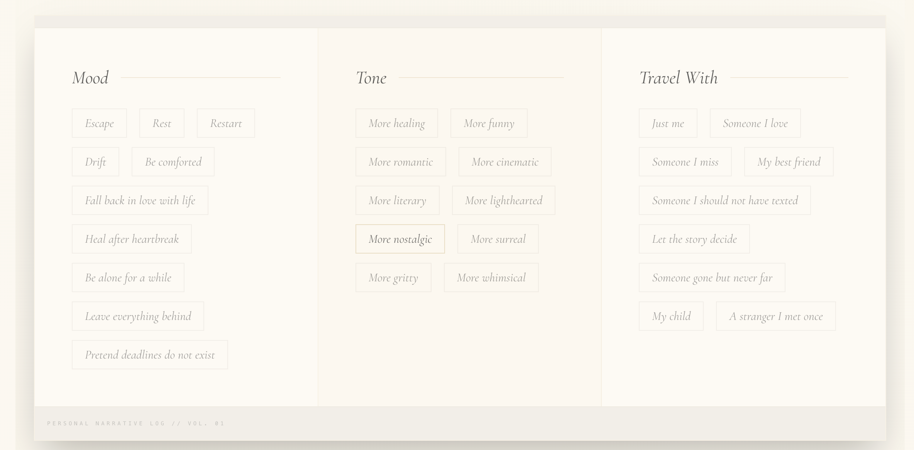
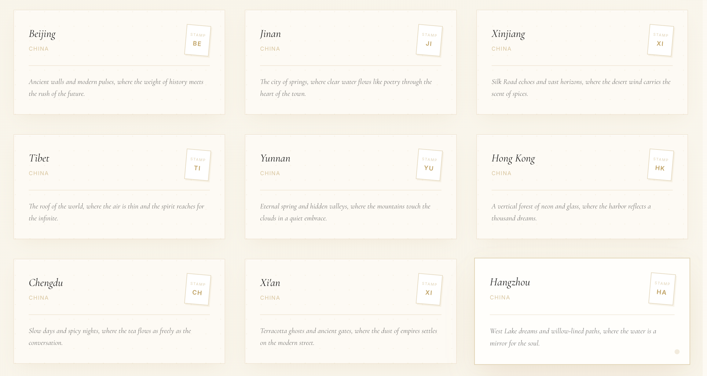
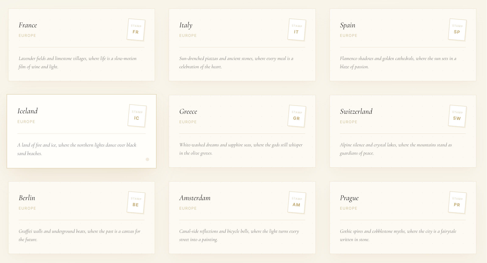
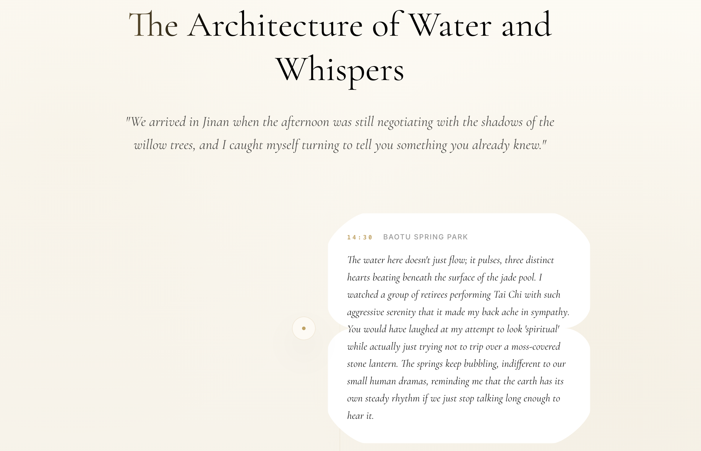
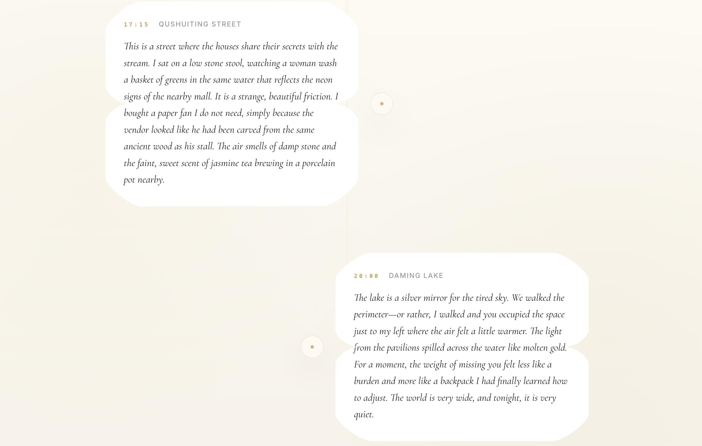
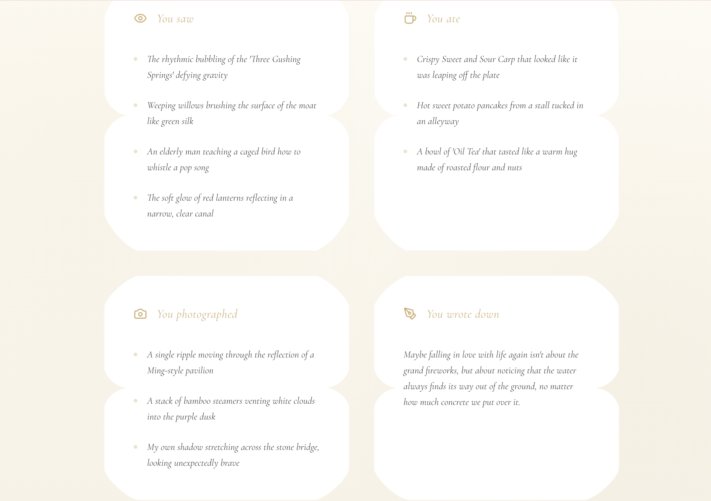
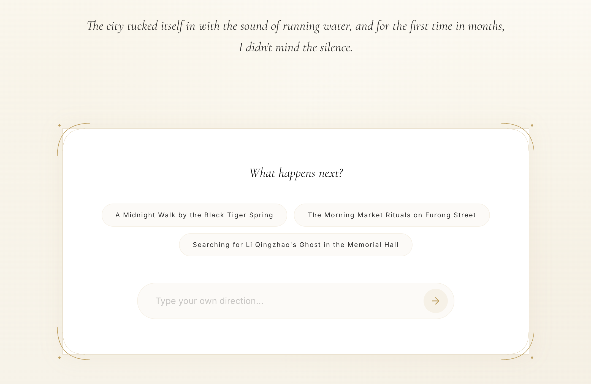

# If You Disappeared on a Trip

*A cinematic AI travel story app that turns moods into vivid little lives somewhere else.*

[Live Demo](https://if-you-disappeared.vercel.app/) · [GitHub](https://github.com/olivia3395/if-you-disappeared)

## About

**If You Disappeared on a Trip** is a narrative travel app for anyone who has ever wanted to quietly disappear for a while.

Instead of building itineraries or travel plans, it transforms a feeling into a **micro travel theater** — a soft, cinematic, slightly funny little life in another place. Users can enter through a mood, a destination, or curated vibe selections, and the app responds with a structured travel story full of atmosphere, sensory details, emotional texture, and recognizable places.

It is not about booking a trip.  
It is about briefly living one.

## Features

- **Mood-to-story generation**  
  Turn a feeling like *“I want to disappear for two days”* into an immersive travel narrative.

- **Cinematic travel storytelling**  
  Generates vivid, scene-based mini stories with a dreamy, healing, and slightly humorous tone.

- **Structured emotional output**  
  Includes a title, opening line, time-based scenes, and reflective sections like what you saw, ate, photographed, or wrote down.

- **Curated vibe controls**  
  Choose mood, tone, and who you travel with.

- **Destination cards**  
  Explore beautifully presented destinations with postcard-inspired UI.

- **Interactive continuation**  
  Designed for follow-up prompts and continued narrative exploration.

## Landing Page

### Mood, Tone, and Travel With

### Destination Cards — China

### Destination Cards — Europe

### Story Title and Opening Scene

### Scene Timeline

### Reflective Story Sections

### What Happens Next

> Place the screenshots inside an `assets/` folder in your repo, or update the image paths if you store them elsewhere.

